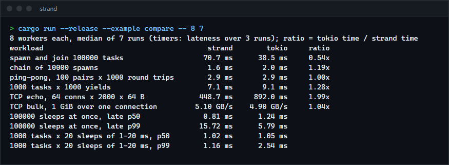

# strand

A small multi-threaded async runtime for Rust, written to show what tokio does underneath: tasks and wakers, a work-stealing scheduler with a cooperative budget, a timing wheel, and a readiness reactor built on AFD polling on Windows and epoll on Linux. It runs real TCP and UDP programs, and every part is measured against tokio on the same machine.

**Status:** v0.1.0, working on Windows. The Linux reactor (epoll) compiles in the checks but was not run. Not published to crates.io; use it as a git dependency.



## Features

- `Runtime::block_on`, `spawn`, `spawn_blocking`, `yield_now`, and a `JoinHandle` that gives the output, the panic, or a cancellation (`abort`).
- Worker threads with a lock-free run queue each, a LIFO slot for the task just woken, work stealing, and an injector for tasks woken from outside.
- A cooperative budget of 128 operations per poll, so a task that is always ready cannot starve the others on its worker (timers included).
- `time::sleep`, `sleep_until`, `timeout` and `interval` on a six-level timing wheel with millisecond ticks.
- `net::TcpListener`, `TcpStream` (connect, read, write, half-close; read and write from two tasks at once) and `UdpSocket`.
- `sync::oneshot` and `sync::mpsc` (bounded and unbounded) channels.
- Dropping the runtime cancels every pending task, dropping the futures (and so the sockets and timers they hold).

## How to install

Requires a recent stable Rust (built and tested with 1.98.1).

```toml
[dependencies]
strand = { git = "https://github.com/r3clusionn/async-runtime", package = "async-runtime" }
```

## How to use

```rust
use std::time::Duration;
use strand::net::TcpListener;
use strand::time::timeout;

fn main() -> std::io::Result<()> {
    let rt = strand::Runtime::new()?; // one worker per logical CPU; Builder::new().workers(n) to choose
    rt.block_on(async {
        let listener = TcpListener::bind("127.0.0.1:7000")?;
        loop {
            let (conn, _) = listener.accept().await?;
            strand::spawn(async move {
                let mut buf = vec![0u8; 4096];
                // Echo until the peer closes, or a minute passes without data.
                while let Ok(Ok(n)) = timeout(Duration::from_secs(60), conn.read(&mut buf)).await {
                    if n == 0 || conn.write_all(&buf[..n]).await.is_err() {
                        break;
                    }
                }
            });
        }
    })
}
```

That is `examples/echo.rs` (`cargo run --release --example echo`). `examples/compare.rs` runs the benchmarks below.

| Item | What it does |
|---|---|
| `Runtime::new()`, `Builder::new().workers(n).build()` | Start the worker threads, the I/O driver and the timers. |
| `rt.block_on(fut)` | Run `fut` on the calling thread until it completes. |
| `spawn(fut)`, `Handle::current().spawn(fut)` | Run `fut` as a task; await the `JoinHandle` for its output. |
| `spawn_blocking(f)` | Run a blocking function on a separate pool (up to 512 threads, each kept 10 s when idle). |
| `JoinHandle::abort()` | Drop the task's future at its next await point; awaiting gives `JoinError::Cancelled`. |
| `time::sleep(d)`, `timeout(d, fut)`, `interval(d)` | Wait; bound a future; tick at a fixed rate (missed ticks are skipped). |
| `net::TcpStream::connect`, `read`, `write_all`, `shutdown_write` | TCP without blocking a worker. |
| `sync::oneshot::channel()`, `sync::mpsc::channel(n)`, `unbounded()` | Pass values between tasks. |

## How it works

**Tasks.** A task is one allocation holding its future, then its output, plus an atomic state of a few bits. `SCHEDULED` means it is in a run queue, so another wake does nothing; `RUNNING` means a worker is polling it, so a wake only sets `NOTIFIED` and the worker queues it again when the poll returns; `COMPLETE` means the future is gone and the output waits for the `JoinHandle`. This guarantees a task is queued at most once and polled by one thread at a time. A panic in a task is caught and returned through the `JoinHandle`. The waker is the task itself (`std::task::Wake` on its `Arc`), so waking allocates nothing.

**Scheduling.** Each worker has a ring of 256 tasks that it pushes to and pops from without locks, and that idle workers steal half of with a compare-and-swap; this is tokio's algorithm, and it was model-checked with loom here. A task woken by a worker goes into that worker's LIFO slot and runs next (at most three times in a row), so two tasks passing messages stay on one thread. New tasks and yields go to the back of the queue. Tasks woken from outside the runtime go to a shared injector, which workers take batches from. Every 61 tasks a worker also checks the injector and polls the I/O driver, so neither waits behind a busy queue.

**Sleeping workers.** One idle worker blocks in the I/O driver, with a timeout set by the next timer; the others sleep on a condition variable. A worker's parker knows which of the two it is in and wakes it the right way. When work arrives, one sleeper is woken; while it is still looking for work, no other is, which avoids waking every worker for one task.

**Cooperative budget.** Each poll of a task gets 128 units. Every operation that completes (a message received, bytes read, a timer fired, a task joined) spends one; when they are gone, operations return `Pending` and wake the task at once, which puts it behind the others. A test checks that a task draining a channel of two million ready messages on a one-worker runtime does not delay a 5 ms timer until it is done.

**Timers.** A hierarchical timing wheel: six levels of 64 slots, 1 ms per slot at the bottom, 795 days in all. Inserting and removing a timer is O(1); each level keeps a bitmask of occupied slots, so the next deadline is found with a few bit operations. A timer in a higher level moves down a level when its slot comes due, at most five times. Deadlines are rounded up to the next millisecond, so a sleep never ends early. Adding a timer that is due before the driver's current wait ends wakes the driver. On Windows the driver's timed wait is a high-resolution waitable timer whose expiry is posted to the completion port (`NtAssociateWaitCompletionPacket`), because the port's own timeout ends on the system timer tick, up to 15.6 ms late.

**I/O on Windows.** Windows has no epoll, but every socket belongs to the AFD driver, which accepts a poll request (`IOCTL_AFD_POLL`) for a set of events. Sent asynchronously on a handle bound to an I/O completion port, the request completes on that port when an event happens: epoll's readiness model on top of completion ports, as mio (tokio) and wepoll do it. A request is one-shot, so a new one is sent whenever a task waits for something the last one did not report; if a task needs an event the pending request lacks, that request is cancelled and resent. The request's memory lives in the socket's state, which a reference handed to the kernel keeps alive until the completion is dequeued, so closing a socket with a request pending is safe.

**I/O on Linux.** epoll, edge-triggered, with each socket registered once for both directions and events carrying a token that is looked up, so an event for a socket closed meanwhile finds nothing.

**Readiness.** A task tries its non-blocking call first. On `WouldBlock` it clears the readiness bit and waits for the next event. The readiness word holds an event counter, and the clear only applies if the counter has not moved since the task looked, so an event arriving between the failed call and the clear is not lost.

## Measurements

Intel Core i9-14900KF (24 cores), 32 GB, Windows 11 23H2, Rust 1.98.1, release build with LTO, tokio 1.54.1. `cargo run --release --example compare -- 8 7`: both runtimes with 8 workers in the same process, the same code for each workload, alternating runs; times are the median of 7 runs, timer lateness is pooled over 3 runs. A ratio above 1 means strand took less time.

| Workload | strand | tokio | Ratio |
|---|---|---|---|
| Spawn 100,000 tasks from `block_on` and join them | 70.7 ms | 38.5 ms | 0.54 |
| A chain of 10,000 tasks, each spawning the next | 1.6 ms | 2.0 ms | 1.19 |
| 100 pairs of tasks, 1,000 round trips each over bounded channels | 2.9 ms | 2.9 ms | 1.00 |
| 1,000 tasks yielding 1,000 times each | 7.1 ms | 9.1 ms | 1.28 |
| TCP echo over loopback: 64 connections, 2,000 round trips of 64 bytes each | 448.7 ms | 892.0 ms | 1.99 |
| TCP, 1 GiB over one loopback connection | 5.10 GB/s | 4.90 GB/s | 1.04 |

| How late a sleep woke | strand | tokio |
|---|---|---|
| 100,000 sleeps of 1 to 100 ms started at once, median | 0.81 ms | 1.24 ms |
| the same, 99th percentile | 15.72 ms | 5.79 ms |
| 1,000 tasks sleeping 20 times each for 1 to 20 ms, median | 1.02 ms | 1.05 ms |
| the same, 99th percentile | 1.16 ms | 2.54 ms |

What the numbers say:

- **Spawning many tasks is strand's weak spot with many workers.** `examples/spawn_profile.rs` splits the first row: with one worker, spawning the 100,000 from `block_on` takes 19 ms in both runtimes, and spawning and joining them from inside a task takes 17 ms against tokio's 26 ms. With eight workers strand needs 50 ms from `block_on` against 36 ms (every task passes through one locked injector that the workers also take from) and 33 to 46 ms from inside a task against 28 ms. The burst of 100,000 sleeps shows the same thing: the late tail is tasks waiting for a worker while the burst is still being spawned.
- **Steady sleeps are as accurate as a 1 ms wheel allows.** Each wait in the driver uses a high-resolution waitable timer that posts to the completion port when it fires (as Go's runtime does), instead of the port's own millisecond timeout, which Windows ends on its timer tick (up to 15.6 ms). A sleep that starts right after the previous one woke is rounded up to the next millisecond, hence the 1 ms median.
- Found while tuning: putting newly spawned tasks at the back of the queue instead of the LIFO slot made the chain of spawns 4.7 times slower (7.5 ms), and taking a batch from the injector used to copy everything left in it, which cost about 13 ms on the first row.

## Checked by

- **Tests**: 42 (`cargo test`): the task state machine against a plain queue (completion, wakes from other threads and during a poll, a task queued once however often it is woken, abort before, during and after running, panics, detached output, shutdown); the run queue (overflow, stealing, three thieves against the owner); the timing wheel (every timer fires at its exact millisecond from any start time, jumps, removal, deadlines beyond its span, and `next_deadline` never later than a pending timer over 200 random rounds); the runtime (100,000 tasks over 8 workers, chains, panics, abort, shutdown dropping tasks parked on sockets and timers, the budget, `spawn_blocking`, sleeps in order and never early, 20,000 timers half cancelled); and the network (echo, 200 clients at once, 64 MiB intact, refused connections, half-close, UDP, aborting a task blocked in a read, reading and writing one stream from two tasks).
- **Miri** (`cargo +nightly miri test --lib task` and `queue::tests`, several seeds): the task state machine, the `AtomicWaker`, the oneshot channel and the run queue under three thieves, with no undefined behaviour reported.
- **loom** (`RUSTFLAGS="--cfg loom" cargo test --release --lib loom_tests`): every interleaving of the run queue's owner with one thief across an overflow, and of two thieves at once.
- **Repetition**: the runtime and network suites run 120 times each over the final changes (60 per round, under a two-minute timeout per run) with no failure or hang.

## Limits

- No single-threaded runtime, no file I/O (use `spawn_blocking`), no signals, no `select!` macro; TCP and UDP only.
- Timers have a resolution of 1 ms (the wheel's tick); a sleep ends up to 1 ms after its deadline, never before.
- Spawning many tasks from outside the runtime (from `block_on`) is slower than tokio (see the table): all of them pass through one locked injector queue.
- Linux: written and compiled, not run. macOS and the BSDs have no reactor (kqueue is not written).

## License

MIT (see `LICENSE`).
